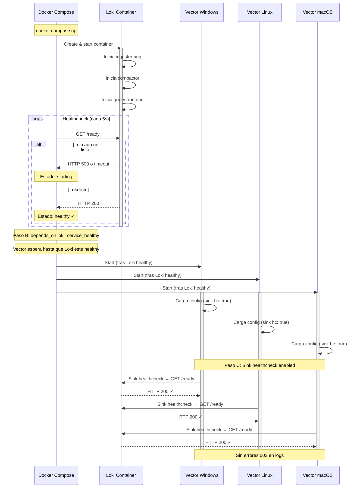
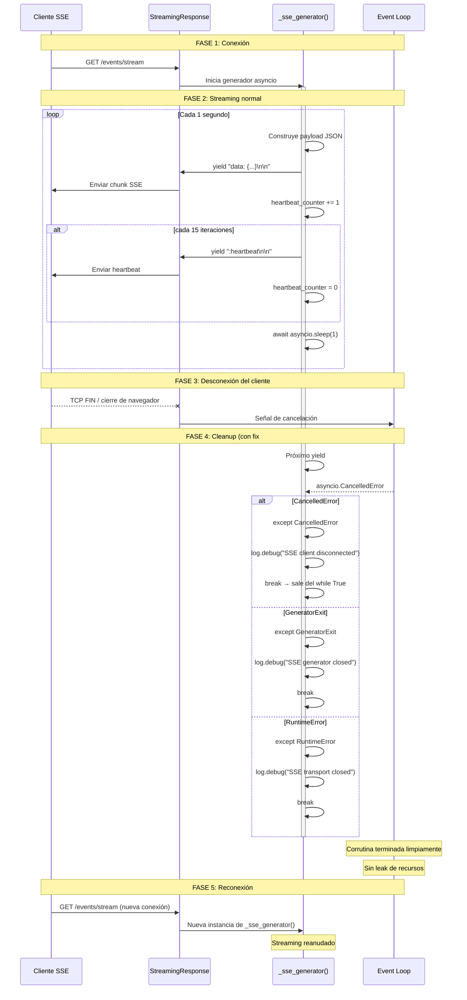
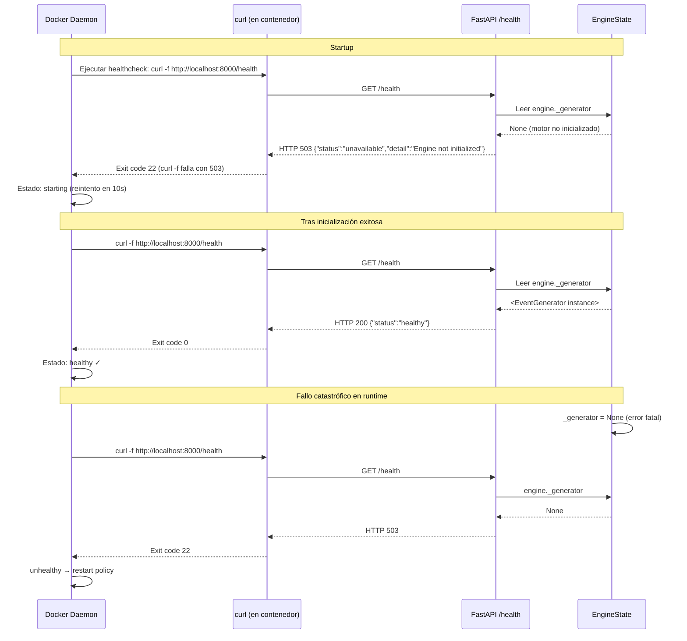

# Design: Critical Data Integrity Fixes

**Change ID:** `critical-data-integrity`

**Date:** 2026-05-18

**Status:** Draft

---

## Table of Contents

1. [Overview](#overview)
2. [Architecture Decision Records](#architecture-decision-records)
3. [#25 — Vector/Loki Reliability (infra)](#25--vectorloki-reliability-infra)
4. [#26 — SSE Disconnect Handling (API)](#26--sse-disconnect-handling-api)
5. [#27 — Health Endpoint (API)](#27--health-endpoint-api)
6. [#28 — Loop Guard (API)](#28--loop-guard-api)
7. [#10 — B023 Lambda Investigation (API)](#10--b023-lambda-investigation-api)
8. [Cross-Cutting Concerns](#cross-cutting-concerns)
9. [Test Strategy Summary](#test-strategy-summary)
10. [Rollout & Verification Plan](#rollout--verification-plan)

---

## Overview

Este documento de diseño cubre cinco bugs de integridad de datos en el proyecto BankRange. Cuatro residen en `adapters/inbound/api/app.py` (archivo central de la API de comando y control) y uno en la capa de infraestructura de observabilidad (Vector + Loki en Docker Compose). Todos comparten la propiedad de afectar la confiabilidad operativa del pipeline.

### Affected Files and Change Surface

| Fix       | File(s)                                             | Est. Δ Lines | Nature                                 |
| --------- | --------------------------------------------------- | ------------ | -------------------------------------- |
| #25       | `docker-compose.yml`, `config/vector/*.yaml`        | ~26          | Infra config                           |
| #26       | `adapters/inbound/api/app.py`                       | ~12          | Exception handling                     |
| #27       | `adapters/inbound/api/app.py`, `docker-compose.yml` | ~18          | New endpoint + config                  |
| #28       | `adapters/inbound/api/app.py`                       | ~0           | Verification (guard already correct)   |
| #10       | —                                                   | ~0           | Verification (no lambda in loop found) |
| **Total** |                                                     | **~56**      |                                        |

### Dependency Map

```
┌──────────────────────────────────────────────────────────────┐
│  #25: Infra (docker-compose.yml + Vector configs)            │
│       ↓ (partial: docker-compose.yml shared line for       │
│         API healthcheck test command with #27)              │
│  #27: /health endpoint (app.py + docker-compose.yml)        │
│                                                              │
│  #26: SSE leak (app.py)  ← independent                      │
│  #28: Loop guard (app.py) ← independent, verify-only        │
│  #10: B023 lambda    ← independent, verify-only             │
└──────────────────────────────────────────────────────────────┘
```

#25 y #27 comparten `docker-compose.yml` (una línea del healthcheck de `bankrange-api`). Los demás fixes son ortogonales dentro de `app.py` (tocan funciones distintas: `_sse_generator`, endpoint `/health`, `_run_engine_loop`).

---

## Architecture Decision Records

### ADR-1: Endpoint /health separado en lugar de modificar /status

**Contexto:** El healthcheck actual de Docker usa `GET /status`, que siempre retorna HTTP 200 sin importar si el motor está inicializado. Esto produce un falso positivo: Docker cree que la API está lista cuando en realidad el motor falló al arrancar.

**Decisión:** Crear un endpoint dedicado `GET /health` con semántica de healthcheck operacional (200 ↔ healthy, 503 ↔ unavailable). Preservar `GET /status` sin cambios para dashboards y consumidores externos.

**Alternativas consideradas:**

1. _Modificar /status para retornar 503 cuando el motor no está listo._ Rechazada: rompe consumidores existentes (Streamlit dashboard, scripts de monitoreo) que esperan HTTP 200 siempre.
2. _Agregar un campo `healthy: bool` dentro de /status._ Rechazada: el healthcheck de Docker necesita código de salida de curl, no parseo de JSON.
3. _Usar el endpoint de FastAPI `/docs` o `/openapi.json`._ Rechazada: no refleja el estado del motor.

**Consecuencias:**

- Separación clara de concerns: `/status` = informativo, `/health` = operacional.
- Compatibilidad hacia atrás garantizada.
- Una ruta adicional mínima en el router de FastAPI (~10 líneas).

### ADR-2: Código HTTP 503 para /health cuando el motor no está inicializado

**Contexto:** Cuando `engine._generator is None`, la API está corriendo pero no puede servir su función principal (generar eventos de simulación). Se necesita un código HTTP que indique "servicio no disponible temporalmente".

**Decisión:** Usar HTTP 503 Service Unavailable.

**Alternativas consideradas:**

1. _HTTP 500 Internal Server Error._ Rechazada: 500 implica un error del servidor, no una condición transitoria de inicio. Además, `curl -f` trata 500 como fallo igual que 503, así que no hay diferencia práctica para Docker, pero la semántica es incorrecta.
2. _HTTP 200 con `{"status": "unhealthy"}`._ Rechazada: `curl -f` solo verifica el código HTTP. Un 200 con cuerpo de error sería un falso positivo para Docker healthcheck.
3. _HTTP 503 con cuerpo descriptivo._ **Seleccionada.** 503 es el código canónico para "servicio temporalmente no disponible". Es el esperado por orchestrators (Docker, Kubernetes) durante el arranque. El cuerpo incluye información de diagnóstico.

**Consecuencias:**

- Docker interpreta correctamente el estado del contenedor.
- Durante el arranque normal (motor inicializando), `/health` retorna 503 → Docker mantiene el contenedor en `starting` → después de `retries` exitosos transiciona a `healthy`.
- Si el motor falla catastróficamente en runtime, `/health` transiciona a 503 → Docker puede reiniciar el contenedor.

### ADR-3: Orden obligatorio A → B → C para el fix #25

**Contexto:** El fix de infraestructura Vector↔Loki requiere tres sub-cambios. El orden de aplicación determina si el fix es correcto o si introduce ruido 503 (el mismo problema que el commit `0fd397e` intentó suprimir).

**Decisión:** Aplicar los sub-cambios en orden estricto A → B → C:

| Paso  | Cambio                                                               | Archivo                |
| ----- | -------------------------------------------------------------------- | ---------------------- |
| **A** | Añadir healthcheck a Loki (`/ready`)                                 | `docker-compose.yml`   |
| **B** | Cambiar Vector `depends_on` de `service_started` a `service_healthy` | `docker-compose.yml`   |
| **C** | Habilitar `healthcheck.enabled: true` en sinks Vector                | `config/vector/*.yaml` |

**Justificación de la atomicidad:**

- **C sin A y B:** Vector habilita healthcheck del sink cuando Loki aún no tiene healthcheck propio. Vector puede iniciar antes que Loki (`service_started` no espera readiness real). Resultado: el sink healthcheck detecta Loki como `unhealthy` → logs llenos de errores 503. **Este es el anti-patrón que anula el propósito del fix.**
- **A y B sin C:** El startup es correcto (Vector espera a Loki healthy), pero en runtime, si Loki crashea, Vector no lo detecta porque el sink healthcheck está deshabilitado. Los eventos se pierden silenciosamente.
- **A → B → C:** Loki está healthy antes de que Vector inicie. Vector habilita el healthcheck del sink cuando Loki ya responde. Sin falsos positivos en startup. Detección de caídas en runtime.

**Consecuencias:**

- El orden de los commits dentro del PR debe respetar A → B → C.
- Si se necesita revertir, el orden de reversión es C → B → A.
- Cada paso es atómicamente verificable: A se prueba con `docker compose up loki`, B con `docker compose up vector-*`, C inspeccionando logs de Vector.

### ADR-4: Excepciones a capturar en \_sse_generator()

**Contexto:** Cuando un cliente SSE cierra la conexión, el `yield` dentro de `_sse_generator()` recibe una señal de interrupción. Se necesita determinar qué excepciones específicas capturar para una limpieza correcta sin suprimir errores legítimos.

**Decisión:** Capturar explícitamente `asyncio.CancelledError`, `GeneratorExit`, y `RuntimeError` alrededor del `yield`.

**Justificación por tipo de excepción:**

| Excepción                | Origen                                                                                        | Cuándo ocurre                                                                                                  |
| ------------------------ | --------------------------------------------------------------------------------------------- | -------------------------------------------------------------------------------------------------------------- |
| `asyncio.CancelledError` | FastAPI/Starlette cancela la tarea asyncio asociada al stream cuando el cliente se desconecta | El event loop propaga la cancelación hacia la corrutina, que está bloqueada en `yield` o `await asyncio.sleep` |
| `GeneratorExit`          | El consumidor del generador (`StreamingResponse`) cierra la iteración                         | `StreamingResponse.__anext__()` deja de iterar; Python lanza `GeneratorExit` dentro del generador              |
| `RuntimeError`           | El transporte subyacente (socket TCP) ya fue cerrado                                          | La aplicación intenta escribir en un socket cerrado; Starlette envuelve esto en `RuntimeError`                 |

**Por qué NO capturar `Exception` genérica:**

- Suprimiría errores legítimos del generador (ej. fallo al serializar JSON, error en `datetime.now()`).
- Violaría el principio de "fail loud" para bugs reales.
- Haría debugging extremadamente difícil (errores silenciosos).

**Alternativas consideradas:**

1. _Capturar solo `GeneratorExit`._ Rechazada: no cubre cancelación asyncio ni errores de transporte.
2. _Usar `except Exception` genérico._ Rechazada: suprime bugs legítimos.
3. _Try/except alrededor de todo el `while True`._ Rechazada: el `yield` está dentro del bucle; si la excepción no se captura en el punto del `yield`, el generador se cierra sin cleanup.

**Consecuencias:**

- Cada excepción capturada → log a nivel DEBUG/INFO → `break` del bucle → corrutina termina.
- Si ocurre una excepción no esperada, se propaga y es visible en logs (comportamiento fail-safe).

### ADR-5: Verificación de B023 — No existe lambda vulnerable

**Contexto:** El análisis estático original (flake8-bugbear B023) reportó una lambda capturando variable de bucle por referencia en `app.py`. La inspección del código actual revela que:

- **`app.py`**: No contiene ninguna definición de lambda. El archivo entero no tiene la palabra clave `lambda`.
- **`event_generator.py`**: Contiene 28 lambdas en el método `_metadata_value_for()`, todas definidas dentro de un diccionario literal (`generators: dict = {...}`). Este diccionario se crea una vez por invocación del método, no dentro de un bucle. Las lambdas capturan `self._rng` por closure legítimo (atributo de instancia, no variable de iteración). El bucle `for key in template.metadata_keys:` en `_generate_metadata()` solo hace lookups del diccionario, sin definir lambdas nuevas.

**Decisión:** No modificar código. El bug se cierra como "verificado: no existe lambda vulnerable en el código actual".

**Hipótesis sobre el origen del falso positivo:**

- El reporte pudo originarse de una versión anterior del código donde sí existía una lambda en un bucle.
- O la herramienta de análisis estático reportó un falso positivo (B023 puede ser sensible a closures en comprehensions).
- O el reporte fue generado contra un archivo diferente que ya no existe.

**Consecuencias:**

- Cero cambios de código para #10.
- Se documenta el hallazgo en el ticket y en este diseño.
- Si en el futuro se introduce una lambda en un bucle, el análisis estático la detectará.

### ADR-6: Posicionamiento del guard `deployed` en el loop del motor

**Contexto:** El spec para #28 requiere que la verificación `if engine_state.deployed:` sea la primera operación dentro del bucle del motor, antes de cualquier llamada a `generate_tick`, `set_scale_multiplier`, `get_multiplier`, o `estimated_eps`.

**Hallazgo:** El código actual de `_run_engine_loop()` **ya satisface este requisito**. La estructura actual es:

```python
while engine_state.is_running:
    if engine_state.deployed:
        loop_start = time.time()
        sim_time = datetime.now(UTC)
        base_multi = BANK_WORKDAY_PROFILE.get_multiplier(sim_time)
        # ... simulation logic
    else:
        await asyncio.sleep(1)
```

El guard `if engine_state.deployed:` es la primera operación sustantiva del cuerpo del bucle. Todas las llamadas a `get_multiplier`, `set_scale_multiplier`, `generate_tick`, y `estimated_eps` están dentro del bloque `if`, y jamás se ejecutan cuando `deployed = False`.

**Decisión:** No modificar código. El fix #28 se reduce a verificación y documentación. La prueba existente `test_run_engine_loop_skips_generation_when_not_deployed` ya verifica este comportamiento.

**Nota sobre la discrepancia con el spec:** El spec describe un "current flow" hipotético (`while True → sleep if not deployed → else simulate`) que no coincide con el código real. El código ya implementa el "new flow" descrito en el spec (`while True → if not deployed sleep+continue → simulate`). Esto sugiere que el bug pudo haber sido corregido en un commit intermedio, o que el spec fue escrito contra una versión anterior. La verificación confirma que el código actual es correcto.

---

## #25 — Vector/Loki Reliability (infra)

### Current State Analysis

**`docker-compose.yml` — Servicio Loki (líneas ~167-173):**

```yaml
loki:
  image: grafana/loki:3.0.0
  container_name: bankrange-loki
  ports:
    - "3100:3100"
  command: -config.file=/etc/loki/local-config.yaml
  restart: unless-stopped
  # ❌ NO healthcheck definido
```

**`docker-compose.yml` — Servicios Vector (líneas ~131-165):**

```yaml
vector-windows:
  depends_on:
    loki:
      condition: service_started # ❌ No espera readiness de Loki
```

**`config/vector/*.yaml` — Sinks Loki (3 archivos):**

```yaml
out_loki:
  type: "loki"
  endpoint: "http://loki:3100"
  healthcheck:
    enabled: false # ❌ No verifica conectividad
```

### Component Interaction Diagram

```
┌──────────────────────────────────────────────────────────────────────┐
│                        DOCKER COMPOSE ORCHESTRATION                    │
│                                                                      │
│  ┌──────────┐     ┌──────────────┐     ┌───────────────────────────┐ │
│  │  Kafka   │     │  kafka-init  │     │          Loki             │ │
│  │ (broker) │◄────│ (crea tópicos)│     │  ┌─────────────────────┐ │ │
│  │          │     │              │     │  │ /ready → HTTP 200    │ │ │
│  │ :29092   │     │ completed    │     │  │ cuando ingester     │ │ │
│  │ healthy  │     │ successfully │     │  │ ring está listo     │ │ │
│  └────┬─────┘     └──────┬───────┘     │  └─────────────────────┘ │ │
│       │                  │             └───────────┬───────────────┘ │
│       │    ┌─────────────┼────────────────────────┼──┐              │
│       │    │             │                        │  │              │
│       ▼    ▼             ▼                        ▼  │              │
│  ┌──────────────────────────────────────────────────┐ │              │
│  │              Vector Services (×3)                 │ │              │
│  │  ┌────────────┐  ┌──────────┐  ┌──────────────┐ │ │              │
│  │  │  windows   │  │  linux   │  │    macos     │ │ │              │
│  │  │            │  │          │  │              │ │ │              │
│  │  │ Kafka src  │  │ Kafka src│  │ Kafka src    │ │ │              │
│  │  │   ↓        │  │   ↓      │  │   ↓          │ │ │              │
│  │  │ transform  │  │ transform│  │ transform    │ │ │              │
│  │  │   ↓        │  │   ↓      │  │   ↓          │ │ │              │
│  │  │ Loki sink  │  │ Loki sink│  │ Loki sink    │ │ │              │
│  │  │ ✓ hc:true  │  │ ✓ hc:true│  │ ✓ hc:true   │ │ │              │
│  │  └────────────┘  └──────────┘  └──────────────┘ │ │              │
│  └──────────────────────────────────────────────────┘ │              │
│                                                       │              │
│  depends_on:                                          │              │
│    kafka:        service_healthy                      │              │
│    kafka-init:   service_completed_successfully       │              │
│    loki:         service_healthy  ← CAMBIO CLAVE      │              │
└──────────────────────────────────────────────────────┘              │
```

### Sequence Diagram: Startup A → B → C



### Data Flow: Evento → Kafka → Vector → Loki

```
Workstation                           Vector                     Loki
    │                                    │                         │
    │  generate_tick()                   │                         │
    │──────────► Kafka Topic             │                         │
    │  bankrange-raw-{os}                │                         │
    │                                    │  consume (kafka src)    │
    │                                    │◄─────────────────────── │
    │                                    │                         │
    │                                    │  transform (remap)      │
    │                                    │  ├─ parse XML/Syslog    │
    │                                    │  ├─ extract fields      │
    │                                    │  └─ normalize labels    │
    │                                    │                         │
    │                                    │  sink out_loki          │
    │                                    │  ├─ healthcheck: true   │
    │                                    │  │  GET /ready ─────────►│
    │                                    │  │           200 ◄──────│
    │                                    │  │                       │
    │                                    │  POST /loki/api/v1/push─►│
    │                                    │  │                       │
    │                                    │  │  ┌──────────────────┐ │
    │                                    │  │  │ Ingester →       │ │
    │                                    │  │  │  Compactor →     │ │
    │                                    │  │  │  Object Store    │ │
    │                                    │  │  └──────────────────┘ │
    │                                    │  │           200 ◄──────│
    │                                    │                         │
    │                                    │  Si Loki crashea:       │
    │                                    │  ├─ healthcheck detecta │
    │                                    │  ├─ sink → unhealthy    │
    │                                    │  └─ buffer + retry      │
```

### Anti-Pattern: Qué sucede si se viola el orden A → B → C

```
┌─────────────────────────────────────────────────────────────────┐
│  ESCENARIO DE FALLO: Solo C (sin A ni B)                        │
│                                                                 │
│  1. docker compose up                                           │
│  2. Loki arranca (sin healthcheck)                              │
│  3. Vector inicia inmediatamente (service_started, no espera)   │
│  4. Vector sink healthcheck: GET /ready → Loki                   │
│  5. Loki aún está inicializando → NO responde /ready             │
│  6. Sink healthcheck: UNHEALTHY                                  │
│  7. Logs de Vector:                                             │
│     WARN sink{name=out_loki}: Healthcheck failed:                │
│     HTTP 503 Service Unavailable                                │
│  8. Vector reintenta → más 503 → ruido en logs                  │
│  9. Eventos en buffer pueden expirar si Loki tarda              │
│                                                                 │
│  RESULTADO: Exactamente el problema que el commit               │
│  0fd397e intentó suprimir al deshabilitar el healthcheck.       │
└─────────────────────────────────────────────────────────────────┘
```

### Implementation Notes

| Archivo                      | Cambio            | Detalle                                                                                                                            |
| ---------------------------- | ----------------- | ---------------------------------------------------------------------------------------------------------------------------------- |
| `docker-compose.yml`         | Loki healthcheck  | `test: ["CMD", "wget", "--spider", "-q", "http://localhost:3100/ready"]` o `curl -f`. `interval: 5s`, `timeout: 5s`, `retries: 5`. |
| `docker-compose.yml`         | Vector depends_on | Cambiar `loki: condition: service_started` → `service_healthy` en los 3 servicios Vector.                                          |
| `config/vector/windows.yaml` | Sink healthcheck  | `healthcheck.enabled: false` → `true`.                                                                                             |
| `config/vector/linux.yaml`   | Sink healthcheck  | `healthcheck.enabled: false` → `true`.                                                                                             |
| `config/vector/macos.yaml`   | Sink healthcheck  | `healthcheck.enabled: false` → `true`.                                                                                             |

### Gotchas

1. **Loki `/ready` vs `/metrics`:** El endpoint `/ready` de Loki reporta 200 cuando el ingester ring está completamente inicializado. `/metrics` siempre responde 200 incluso durante el arranque. Usar `/ready` es crítico.
2. **Imagen Loki `grafana/loki:3.0.0`:** Esta imagen incluye `wget` (busybox) pero no `curl`. El healthcheck debe usar `wget --spider -q http://localhost:3100/ready` o instalar `curl`. Alternativa: usar `CMD-SHELL` con redirección.
3. **`restart: unless-stopped` en Vector:** Con `depends_on: service_healthy`, si Loki crashea en runtime, Vector NO se reinicia automáticamente (Docker Compose no tiene liveness probes). El sink healthcheck de Vector es la única defensa en runtime.
4. **Kafka + kafka-init:** Las dependencias existentes (`service_healthy` y `service_completed_successfully`) se preservan sin cambios. Vector depende de Kafka, kafka-init, Y Loki.

---

## #26 — SSE Disconnect Handling (API)

### Current State Analysis

**Función `_sse_generator()` actual (líneas 312-329):**

```python
async def _sse_generator():
    """Async generator yielding SSE-formatted engine state updates."""
    engine = app.state.engine
    heartbeat_counter = 0
    while True:
        payload = {
            "status": "running" if engine.deployed else "stopped",
            "current_multiplier": engine.multiplier_override,
            "estimated_eps": engine.estimated_eps,
            "total_workstations": engine.total_workstations,
            "timestamp": datetime.now(UTC).isoformat(),
        }
        yield f"data: {json.dumps(payload)}\n\n"    # ← Puede lanzar excepción

        heartbeat_counter += 1
        if heartbeat_counter >= 15:
            yield ":heartbeat\n\n"                   # ← Puede lanzar excepción
            heartbeat_counter = 0

        await asyncio.sleep(1)
```

**Problema:** Cuando el cliente cierra la conexión, el próximo `yield` lanza una excepción (`CancelledError`, `GeneratorExit`, o `RuntimeError`). Como no hay `try/except`, la excepción se propaga y la corrutina queda en un estado indeterminado — potencialmente huérfana, consumiendo recursos del event loop.

### Sequence Diagram: SSE Lifecycle (con fix)



### Component Interaction: Excepción → Cleanup

```
┌──────────────────────────────────────────────────────────────┐
│                _sse_generator() Exception Flow                │
│                                                              │
│  while True:                                                 │
│      try:                                                    │
│          yield payload     ◄── Punto de fallo               │
│          yield heartbeat   ◄── Punto de fallo               │
│          await sleep(1)    ◄── Puede recibir cancelación    │
│      except CancelledError:                                  │
│          log.debug("SSE client disconnect via cancellation") │
│          break  ──────────────────────────────┐              │
│      except GeneratorExit:                    │              │
│          log.debug("SSE generator closed")    │              │
│          break  ──────────────────────────────┤              │
│      except RuntimeError:                     │              │
│          log.debug("SSE transport closed")    │              │
│          break  ──────────────────────────────┤              │
│                                               ▼              │
│  # Fuera del while True:                      │              │
│  # Corrutina termina → event loop libera      │              │
│  # recursos asociados                         │              │
└──────────────────────────────────────────────────────────────┘
```

### Data Flow: StreamingResponse → \_sse_generator → Cliente

```
FastAPI Router                          StreamingResponse
     │                                        │
     │  @app.get("/events/stream")            │
     │────────────────────────────────────────►
     │                                        │
     │             retorna StreamingResponse( │
     │               _sse_generator(),        │
     │               media_type="text/        │
     │               event-stream"            │
     │             )                          │
     │                                        │
     │                              ┌─────────▼──────────┐
     │                              │  Iteración asyncio  │
     │                              │  consume chunks     │
     │                              │  de _sse_generator  │
     │                              └─────────┬──────────┘
     │                                        │
     │                              ┌─────────▼──────────┐
     │                              │  Envía por HTTP     │
     │                              │  (chunked encoding) │
     │                              └────────────────────┘
     │                                        │
     │                              ┌─────────▼──────────┐
     │                              │  Cliente recibe     │
     │                              │  text/event-stream  │
     │                              └────────────────────┘
```

### Implementation Notes

| Ubicación                      | Cambio                                     | Detalle                                                                              |
| ------------------------------ | ------------------------------------------ | ------------------------------------------------------------------------------------ |
| `_sse_generator()`, línea ~319 | Envolver `yield` en try/except             | `try: yield ... except (CancelledError, GeneratorExit, RuntimeError): log...; break` |
| `_sse_generator()`, línea ~324 | Envolver heartbeat `yield` en el mismo try | Mismo bloque, cubre ambos yields                                                     |
| `_sse_generator()`, línea ~327 | `await asyncio.sleep(1)` dentro del try    | La cancelación puede llegar durante el sleep también                                 |

### Gotchas

1. **El try/except debe cubrir AMBOS `yield` y el `await asyncio.sleep`.** Si el cliente se desconecta durante el sleep, `CancelledError` se lanza allí, no en el yield. Un try/except que solo cubra el yield no capturaría este caso.
2. **No usar `except Exception`.** Suprimiría errores legítimos como fallos de serialización JSON o errores en `datetime.now()`.
3. **`CancelledError` en Python 3.8-3.10 hereda de `Exception`; en 3.11+ hereda de `BaseException`.** El proyecto usa Python 3.13 según el Dockerfile. Con 3.13, `CancelledError` es subclase de `BaseException`, así que `except Exception` NO lo capturaría — lo cual es bueno para nuestra estrategia de captura explícita.
4. **Log level:** Usar `logging.DEBUG` o `logging.INFO`. La desconexión de un cliente SSE es un evento normal, no un error. Usar `WARNING` o `ERROR` generaría ruido en producción.
5. **Streamlit dashboard:** El dashboard Streamlit (`bankrange-ui`) se reconecta automáticamente al SSE cuando el usuario refresca o la red fluctúa. El fix garantiza que cada desconexión limpia la corrutina anterior antes de crear una nueva.

---

## #27 — Health Endpoint (API)

### Current State Analysis

**Endpoint `/status` actual (líneas 227-234):**

```python
@app.get("/status", response_model=StatusResponse)
async def get_status() -> dict[str, Any]:
    engine_state = app.state.engine
    return {
        "status": "running" if engine_state.deployed else "stopped",
        "current_multiplier": engine_state.multiplier_override,
        "estimated_eps": engine_state.estimated_eps,
        "total_workstations": engine_state.total_workstations,
    }
```

- Siempre retorna HTTP 200.
- No verifica `engine._generator`.
- Docker healthcheck actual: `curl -f http://localhost:8000/status` → SIEMPRE éxito.

**Problema:** Si `_start_background_engine()` falla (Kafka no disponible, error de configuración), `engine._generator` queda `None`, pero `/status` igual retorna 200. Docker cree que el contenedor está healthy.

### Architecture Decision: /health vs /status

```
┌──────────────────────────────────────────────────────────────┐
│              SEPARACIÓN DE CONCERNS                          │
│                                                              │
│  GET /status                   GET /health                   │
│  ═══════════                   ═══════════                   │
│  Propósito: Dashboard          Propósito: Healthcheck       │
│  Consumidores:                 Consumidores:                 │
│   - Streamlit UI               - Docker healthcheck          │
│   - Scripts de monitoreo       - Kubernetes liveness probe   │
│   - curl manual                - Load balancer               │
│                                                              │
│  Siempre 200                   200 si _generator is not None │
│  Datos operacionales           503 si _generator is None     │
│  (multiplier, EPS, etc.)       {"status": "healthy"}         │
│                                                              │
│  BACKWARD COMPATIBLE           NUEVO ENDPOINT                │
└──────────────────────────────────────────────────────────────┘
```

### Sequence Diagram: Healthcheck Flow



### Data Flow: /health Endpoint

```
Request
  │
  ▼
GET /health ──────────────────────────────────────────────┐
  │                                                        │
  ▼                                                        │
app.state.engine._generator                                │
  │                                                        │
  ├── is not None ──► HTTP 200                             │
  │                   Body: {"status": "healthy"}           │
  │                   curl -f → exit 0 → Docker healthy    │
  │                                                        │
  └── is None ──────► HTTP 503                             │
                      Body: {"status": "unavailable",       │
                             "detail": "Engine not          │
                             initialized"}                  │
                      curl -f → exit 22 → Docker unhealthy │
```

### Docker Compose Healthcheck Update

```yaml
# Antes (actual):
bankrange-api:
    healthcheck:
      test: ["CMD", "curl", "-f", "http://localhost:8000/status"]  # ❌ Falso positivo

# Después (con fix):
bankrange-api:
    healthcheck:
      test: ["CMD", "curl", "-f", "http://localhost:8000/health"]  # ✓ Verifica motor real
      interval: 10s
      timeout: 5s
      retries: 5
```

### Implementation Notes

| Ubicación            | Cambio                                 | Detalle                                            |
| -------------------- | -------------------------------------- | -------------------------------------------------- |
| `app.py`, nueva ruta | `@app.get("/health")`                  | Nuevo endpoint, ~10 líneas                         |
| `app.py`             | `async def health_check() -> Response` | Retorna `Response(status_code=503)` o dict con 200 |
| `docker-compose.yml` | `bankrange-api.healthcheck.test`       | Cambiar `/status` → `/health`                      |

### Gotchas

1. **`Response` vs `JSONResponse`:** Para retornar 503 con cuerpo JSON, usar `from fastapi.responses import JSONResponse` o retornar `Response(content=json.dumps({...}), status_code=503, media_type="application/json")`. FastAPI permite retornar un dict con `status_code` usando `JSONResponse` explícitamente, pero el decorador `@app.get(..., response_model=...)` no es adecuado porque fuerza un schema que no espera 503.
2. **`engine._generator` acceso thread-safe:** En el lifespan actual, `_generator` se asigna en el thread principal antes de crear la tarea asyncio. Las lecturas desde endpoints HTTP son en el mismo event loop. No hay condición de carrera porque `_generator` solo se asigna una vez (en `_start_background_engine`) y no se reasigna concurrentemente.
3. **Timing del healthcheck de Docker:** Con `interval: 10s`, `timeout: 5s`, `retries: 5`, Docker espera hasta 50 segundos para que el motor se inicialice antes de marcar el contenedor como unhealthy. Esto es adecuado para el arranque de Kafka + creación de topología.
4. **Servicio `bankrange-ui` depende de `bankrange-api: service_healthy`:** Con el healthcheck corrigiendo a `/health`, `bankrange-ui` no iniciará hasta que el motor esté realmente listo, evitando pantallas de "connecting..." indefinidas en el dashboard.

---

## #28 — Loop Guard (API)

### Current State Analysis

**Función `_run_engine_loop()` actual (líneas 90-140):**

```python
async def _run_engine_loop(engine_state: EngineState) -> None:
    """The infinite simulation loop wrapped for asyncio."""
    # ... validación inicial ...

    try:
        while engine_state.is_running:
            if engine_state.deployed:            # ← GUARD: primera operación ✓
                loop_start = time.time()
                sim_time = datetime.now(UTC)
                base_multi = BANK_WORKDAY_PROFILE.get_multiplier(sim_time)
                effective_multi = base_multi * engine_state.multiplier_override
                generator.set_scale_multiplier(effective_multi)
                generator.generate_tick(sim_time)
                ticks += 1
                raw_eps = generator.estimated_eps(sim_time)
                engine_state.estimated_eps = _compute_ema_eps(
                    engine_state.estimated_eps, raw_eps
                )
                processing_time = time.time() - loop_start
                sleep_time = max(0.01, 1.0 - processing_time)
                await asyncio.sleep(sleep_time)
            else:
                await asyncio.sleep(1)           # ← Idle correcto ✓
    except asyncio.CancelledError:
        logger.info("Engine Loop cancelled via application shutdown.")
    finally:
        engine_state.is_running = False
        logger.info("Flushing publisher...")
        publisher.flush(5.0)
```

### Verification Result

El guard `if engine_state.deployed:` **ya está posicionado como la primera operación sustantiva** dentro del bucle `while engine_state.is_running:`. El código actual satisface todos los requisitos del spec:

| Requisito del Spec                                             | ¿Cumplido? | Evidencia                                                         |
| -------------------------------------------------------------- | ---------- | ----------------------------------------------------------------- |
| Guard `deployed` como primera operación                        | ✅ Sí      | Línea ~103: `if engine_state.deployed:`                           |
| Zero llamadas a `generate_tick` cuando `deployed=False`        | ✅ Sí      | `generate_tick` solo dentro del bloque `if`                       |
| Zero llamadas a `set_scale_multiplier` cuando `deployed=False` | ✅ Sí      | Ídem                                                              |
| Zero llamadas a `get_multiplier` cuando `deployed=False`       | ✅ Sí      | `BANK_WORKDAY_PROFILE.get_multiplier` solo dentro del bloque `if` |
| Solo `await asyncio.sleep(1)` cuando idle                      | ✅ Sí      | Línea ~132: `else: await asyncio.sleep(1)`                        |
| Transición idle→active vía cambio de `deployed`                | ✅ Sí      | Lectura de `engine_state.deployed` en cada iteración              |

**Prueba existente que verifica este comportamiento:**
`test_run_engine_loop_skips_generation_when_not_deployed` (líneas 350-372 de `test_app.py`) configura `deployed=False` y verifica con `assert_called()` / `assert_not_called()` que `generate_tick` no es invocado.

### Decision

**No se requiere modificación de código.** El bug #28 se cierra como "verificado: el guard ya está correctamente posicionado". Se documenta el hallazgo.

### Efecto sobre `tick_time`, EMA, y `publisher.poll(0)` cuando se omite la simulación

- **`tick_time` / `datetime.now(UTC)`:** No se invoca cuando `deployed=False`. El cálculo de timestamp solo ocurre dentro del bloque `if`.
- **EMA (`engine_state.estimated_eps`):** No se actualiza. Mantiene su último valor calculado (o 0.0 si nunca se desplegó).
- **`publisher.poll(0)`:** No existe en el código actual. El publisher (`KafkaEventPublisher`) expone `publish_batch()` y `flush()`, pero no `poll()`. El `flush()` solo se ejecuta en el bloque `finally` al salir del loop.
- **`ticks`:** No se incrementa. El contador permanece en su último valor (o 0).

---

## #10 — B023 Lambda Investigation (API)

### Investigation Results

#### `app.py` — Verificación

**Búsqueda de `lambda`:** Cero ocurrencias. El archivo `adapters/inbound/api/app.py` no contiene ninguna definición de función lambda.

Funciones definidas en `app.py`:

- `_compute_ema_eps()` — función regular
- `_run_engine_loop()` — función asyncio regular
- `_start_background_engine()` — función regular
- `lifespan()` — generador asyncio (context manager)
- `get_status()`, `control_engine()`, etc. — funciones de ruta FastAPI
- `_sse_generator()` — generador asyncio

Ninguna contiene una lambda, y ninguna está dentro de un bucle que capture variables de iteración.

#### `event_generator.py` — Verificación

**Lambdas encontradas:** 28, todas en `_metadata_value_for()` (líneas 220-309).

**Estructura de las lambdas:**

```python
def _metadata_value_for(self, key: str) -> str | int:
    """Generate a plausible value for a metadata field."""
    generators: dict = {
        "windows_event_id": lambda: self._rng.choice([4624, 4625, ...]),  # ← Captura self._rng
        "logon_type":       lambda: self._rng.choice([2, 3, 7, 10]),
        # ... 26 lambdas más ...
    }
    generator = generators.get(key)
    if generator:
        return generator()
    return f"unknown_{key}"
```

**Análisis de B023:**

| Criterio B023                                                         | Evaluación                                                                  |
| --------------------------------------------------------------------- | --------------------------------------------------------------------------- |
| ¿La lambda está definida dentro de un bucle `for`?                    | ❌ No. Está en un dict literal, definido una vez por invocación del método. |
| ¿La lambda captura una variable de iteración?                         | ❌ No. Captura `self._rng` (atributo de instancia, estable en el tiempo).   |
| ¿Múltiples lambdas comparten referencia a la misma variable de bucle? | ❌ No aplica: no hay bucle.                                                 |

**El bucle `for key in template.metadata_keys:` en `_generate_metadata()` (línea ~215):**

```python
def _generate_metadata(self, template: EventTemplate) -> dict:
    metadata: dict = {}
    for key in template.metadata_keys:    # ← Bucle for
        metadata[key] = self._metadata_value_for(key)   # ← Llama al método, no define lambda
    return metadata
```

Este bucle solo itera sobre keys y llama a `_metadata_value_for()`. No define ninguna lambda nueva. Las lambdas fueron definidas estáticamente en el diccionario `generators` de `_metadata_value_for()`.

### Decision

**No existe lambda vulnerable a B023 en el código actual.** El bug se cierra como "verificado: sin lambda con captura de variable de bucle por referencia".

### Hipótesis sobre el origen del reporte

1. **Falso positivo de flake8-bugbear:** B023 puede ser trigger-happy con closures en general, incluso cuando no hay variable de bucle involucrada. Las lambdas que capturan `self._rng` podrían haber disparado una heurística demasiado amplia.
2. **Código removido:** Es posible que una versión anterior de `app.py` contuviera una lambda en un bucle que ya fue refactorizada.
3. **Reporte contra otro archivo:** El reporte pudo haberse generado contra un archivo temporal o generado que ya no existe.

### Verificación con template de fix (si se hubiera requerido)

En caso de que se hubiera encontrado una lambda vulnerable como:

```python
# ❌ B023: lambda captura 'x' por referencia
for x in items:
    funcs.append(lambda: process(x))
```

El fix canónico es default argument binding:

```python
# ✓ Seguro: lambda captura 'x' por valor
for x in items:
    funcs.append(lambda captured=x: process(captured))
```

Este patrón fuerza la evaluación de `x` en el momento de la definición de la lambda, en lugar de en el momento de la invocación. Es el approach recomendado por la documentación de flake8-bugbear para B023.

---

## Cross-Cutting Concerns

### File Collision Map: `app.py`

Los fixes #26 y #27 modifican `app.py`. Sus zonas de edición son ortogonales:

```
app.py ─────────────────────────────────────────────────────
│
├── Líneas 1-42:   imports, EngineState, DTOs          [Sin cambios]
├── Líneas 43-89:  EMA helper                          [Sin cambios]
├── Líneas 90-140: _run_engine_loop()                  [#28: verify-only]
├── Líneas 141-180: _start_background_engine()        [Sin cambios]
├── Líneas 181-210: lifespan, app definition           [Sin cambios]
├── Líneas 211-234: /status endpoint                   [Sin cambios]
├── Líneas 235-260: /control endpoint                  [Sin cambios]
├── Líneas 261-290: /topology endpoints                [Sin cambios]
│
│   ★ NUEVO: /health endpoint (~10 líneas)             [#27: INSERT aquí]
│
├── Líneas 312-329: _sse_generator()                   [#26: MODIFICAR]
│   └── while True → try/except → yield → break
├── Líneas 331-342: /events/stream endpoint            [Sin cambios]
│
└─────────────────────────────────────────────────────────────
```

Los cambios no se solapan. Se pueden implementar en cualquier orden dentro del archivo.

### File Collision Map: `docker-compose.yml`

Los fixes #25 y #27 modifican `docker-compose.yml`:

```
docker-compose.yml ────────────────────────────────────────
│
├── Líneas 1-65:   kafka, kafka-ui, kafka-init          [Sin cambios]
├── Líneas 66-100:  bankrange-api
│   └── healthcheck.test: /status → /health             [#27: MODIFICAR]
├── Líneas 101-120: bankrange-ui                         [Sin cambios]
├── Líneas 121-165: vector-windows, linux, macos
│   └── depends_on.loki: service_started → service_healthy [#25B: MODIFICAR]
├── Líneas 166-175: loki
│   └── AGREGAR healthcheck block                        [#25A: INSERT]
├── Líneas 176-195: grafana                              [Sin cambios]
│
└─────────────────────────────────────────────────────────────
```

Los cambios están en líneas diferentes y son independientes.

### Strict TDD Compliance

El `config.yaml` del proyecto establece `strict_tdd: true`. Cada fix debe tener sus pruebas escritas y verificadas como fallidas ANTES de implementar el código de producción:

| Fix | Pruebas a escribir                                                    | Archivo de pruebas                                       |
| --- | --------------------------------------------------------------------- | -------------------------------------------------------- |
| #25 | Validación de config YAML (healthcheck presente, depends_on correcto) | `tests/integration/test_vector_configs.py` (extender)    |
| #26 | SSE disconnect: simular cancel, verificar cleanup                     | `tests/unit/adapters/inbound/api/test_app.py` (extender) |
| #27 | `/health` 503 sin motor, `/health` 200 con motor, `/status` intacto   | `tests/unit/adapters/inbound/api/test_app.py` (extender) |
| #28 | Ya existe `test_run_engine_loop_skips_generation_when_not_deployed`   | Verificación (sin cambios)                               |
| #10 | Ya verificado: sin lambda vulnerable                                  | Verificación (sin cambios)                               |

### Test Infrastructure

El comando de pruebas es `uv run pytest tests/ -v`. Los tests existentes en `tests/unit/adapters/inbound/api/test_app.py` usan:

- **Fixture `client`:** `TestClient` con `_start_background_engine` mockeado y `EngineState` inyectado manualmente. Esto permite probar endpoints sin depender de Kafka ni topología real.
- **Fixture `monkeypatch`:** Para modificar atributos de módulo y variables de entorno.
- **`asyncio.run()`:** Para probar corrutinas directamente (`_run_engine_loop`, `_sse_generator`).
- **`unittest.mock.MagicMock`:** Para verificar llamadas a `generate_tick`, `flush`, etc.

Los nuevos tests deben seguir estos patrones existentes.

---

## Rollout & Verification Plan

### Fase 1: Infraestructura (#25)

1. Añadir healthcheck a Loki en `docker-compose.yml`.
2. Verificar: `docker compose up loki` → `docker ps` muestra Loki como `healthy`.
3. Cambiar Vector `depends_on` a `service_healthy`.
4. Verificar: `docker compose up vector-windows` → Vector espera a Loki healthy antes de iniciar.
5. Habilitar `healthcheck.enabled: true` en los 3 archivos de Vector.
6. Verificar: `docker compose up` completo → cero errores 503 en logs de Vector.

### Fase 2: API (#26, #27, #28, #10)

1. Escribir tests para #26 (SSE disconnect) y #27 (/health endpoint).
2. Verificar que los tests fallan (TDD: red phase).
3. Implementar #26 (try/except en `_sse_generator`).
4. Implementar #27 (endpoint `/health` + Docker healthcheck).
5. Verificar que los tests pasan (TDD: green phase).
6. Verificar #28 y #10 (confirmación, sin cambios de código).

### Fase 3: Integración

1. `uv run pytest tests/ -v` — todas las pruebas pasan.
2. `docker compose up` — todos los servicios arrancan sin errores.
3. `curl -f http://localhost:8000/health` → 200 (tras inicialización).
4. `curl http://localhost:8000/events/stream` → Ctrl+C → sin leaks en logs.
5. Dashboard Streamlit en `http://localhost:8080` → funcional.

### Criterios de Reversión

Cada fix es independientemente reversible. Ver [Rollback Plan en proposal.md](./proposal.md#rollback-plan) para estrategia detallada.
